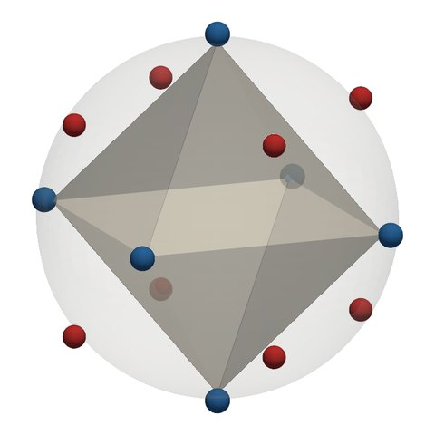
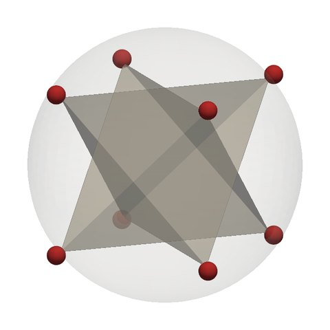
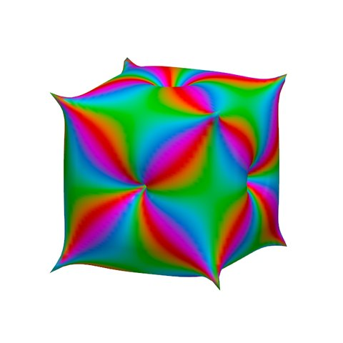
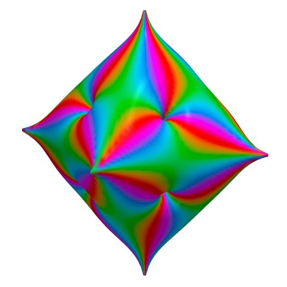

# Related to stellation?

*This page assumes [the recipes](recipes.md), in particular R2.*

The reliefs often look like **stellated** solids, with spikes rising over the faces. The
resemblance is real but partial. R2 shares *tip directions* with some stellations, not their
construction. This page shows where the analogy holds, where it fails, and the stronger link the
construction does have: polar duality.

## Three constructions

**Classical stellation [B]** extends a solid's face planes until they meet again, and builds a
larger solid from pieces of those same planes. Every face of a stellation lies in a face plane
of the original ([G. W. Hart, *Virtual Polyhedra*](https://www.georgehart.com/virtual-polyhedra/stellations-info.html)).

**Kis [B]** raises a pyramid on each face, adding a new vertex over its centre
([Conway notation](https://www.georgehart.com/virtual-polyhedra/conway_notation.html)). On a
regular solid the new vertices point along the face normals.

**R2** puts poles along the face normals and zeros along the vertex directions. The relief is
then a smooth surface determined by all of them together. No face plane constrains it.

| construction | where the tips are | relation to the R2 relief |
|---|---|---|
| classical stellation | where extended face planes meet | some stellations share R2's tip directions; others do not, and some solids have none |
| kis | over each face, along its normal on a regular solid | the closest visual analogy for R2 on regular solids: the same tip directions. R2 also sinks the vertex directions into pits and replaces flat faces with one curved surface |
| R2 relief | spikes along the face normals, pits along the vertex directions | the tips sit at the vertices of the polar dual |
| R4ve / R4fe relief | spikes along the edge directions | a different arrangement, tied to the edges |

## The octahedron: shared tips

The octahedron's eight face normals point to the vertices of a cube. R2 therefore puts eight
spikes there, and six pits at the octahedron's own vertices. The octahedron has exactly one
stellation, the **stella octangula**, a compound of two tetrahedra. Its eight outer tips are at
the same cube vertices, where three extended face planes meet **[D]**.

*The interactive figure needs JavaScript and WebGL. Here it is as still images, from one view.*

<figure markdown>
{ width="100%" }
<figcaption>The octahedron under R2: zeros (blue) at the vertices, poles (red) at the face
normals.</figcaption>
</figure>
<figure markdown>
{ width="100%" }
<figcaption>Its stellation, the stella octangula. The red markers are the same 8 directions.</figcaption>
</figure>
<figure markdown>
{ width="100%" }
<figcaption>The R2 relief: a spike in each of the same 8 directions.</figcaption>
</figure>

 zeros (pits)
 poles (spikes). Drag any view to turn all three; scroll or
pinch to zoom. Hover over or tap a marker to see its order. Switch the solid to the cube to see a
solid with no stellation.

The tips agree; the surfaces do not. The stella octangula is made of flat triangles in the
octahedron's face planes. The relief is curved everywhere and sinks in at the octahedron's
vertices, which the stellation leaves alone.

## The cube: no stellation, same spikes

The cube has **no** finite stellation. Its non-adjacent faces are parallel, so their planes never
meet. R2 on the cube still gives six spikes, one per face. So the recipes are not another way to
compute a stellation: they give spikes where stellation gives nothing. The tetrahedron is the same:
any three of its face planes meet only at a vertex **[D]**.

Other solids give mixed answers. The dodecahedron's stellations include tips along its face
normals (the small stellated dodecahedron) and tips along its vertex directions (the great
stellated dodecahedron), which are where R2 puts *pits* **[N]**. Whether tips coincide depends on
the stellation, not only on the solid.

## The stronger link: polar duality

The construction has an exact relation to the polar dual, rather than a resemblance. With the
site's normalization,

$$
u(x) \;=\; \log|f(x)| \;=\; \sum_i m_i \log \chi(x, a_i),
$$

a balanced logarithmic potential on the sphere: every zero and pole contributes at every point.
The curves between spikes and pits come from all of them together, not from a local operation
on each face. Polarity swaps vertices and faces, so for R2 it negates the divisor, and

$$
u_{P^*}(x) \;=\; -\,u_P(x) \qquad \textbf{[D]}.
$$

The relief radius is \(r = d + (1 - d)\,\sigma(u/k)\), with \(\sigma\) the logistic function.
Since \(\sigma(-t) = 1 - \sigma(t)\), the dual's relief under the same \(d\) and \(k\) is
\(r_{P^*} = (1 + d) - r_P\). Highs and lows swap about the midpoint radius \((1 + d)/2\)
**[D]**:

=== "Octahedron (R2)"

    { width="48%" }

=== "Cube, its polar dual (R2)"

    { width="48%" }

Both use the same order-tuned display (decision 0005), and a solid and its dual get the same
settings. The printed pieces use transfer settings chosen per piece, so a printed pair need not
be exact reflections. To see the two divisors side by side, use
[Compare recipes](compare.md) with "R2 on the cube and on the octahedron".

## What is and is not claimed

!!! note "Status"
    - **Shared tip directions:** derived for the octahedron. Checked for the five Platonic
      solids: the cube and tetrahedron have no stellation, and the dodecahedron and icosahedron
      have stellation tips in several kinds of direction.
    - **Ridges:** whether the relief's ridges follow a stellation's edges is **open**.
    - **A limit:** whether some sharpening of the relief tends to a stellation is **open**. The
      cube shows it cannot hold in general.
    - The recipes are not called "analytic stellation": that name would claim more than is
      established.

Labels: **[B]** established background, **[D]** derived here, **[N]** numerical observation, as
in [the exploration](narrative.md). The checks are in `tests/test_stellation_claims.py`, the
figure is made by `scripts/a8_stellation_figure.py`, and the working note is
`notes/2026-10-16-stellation-analogy.md` in the repository.
